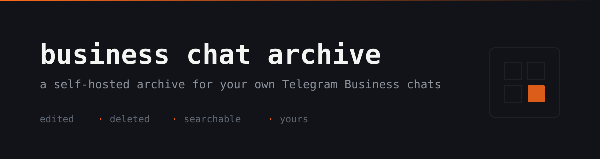

<p align="center">
  
</p>

<p align="center">
  <a href="#license"></a>
  
  
  
  
  
  
</p>

Keeps a record of your own Telegram Business conversations, including the versions of messages that were later edited or deleted.

## Documentation

Guides for operators and developers, in two languages:
[English](docs/en/index.md) · [Oʻzbekcha](docs/uz/index.md).

## Read this before you run it

This bot stores the messages of the people you chat with, including content they later deleted. That has consequences you own, not the author of this code:

| Concern              | What it means for you                                                                                           |
| -------------------- | --------------------------------------------------------------------------------------------------------------- |
| You are the operator | Whoever runs the instance is responsible for the personal data it holds — GDPR, ZRU-547 or the local equivalent   |
| Nobody is told       | Do not assume Telegram informs the other side; check what they see, and tell them yourself                        |
| Telegram may act     | Bots built to defeat message deletion get reported and removed; read the Bot Terms first                          |
| Keep it short        | `RETENTION_DAYS` defaults to 30, and lower is better                                                              |
| Keep it narrow       | Set `DEFAULT_TRACK_MODE=deny` and add chats with `/track`                                                         |

Intended use is a business keeping a record of its own customer conversations, with the other side informed. Monitoring people who do not know is not what this project is for. [Privacy and the law](docs/en/privacy.md) goes into detail.

## How it works

| Event       | What the bot does                                                 |
| ----------- | ----------------------------------------------------------------- |
| New message | Stored, if the chat is archived                                   |
| Edited      | Notifies with the old text struck through above the new one       |
| Deleted     | Notifies with the stored content, then drops the row              |
| Connection  | Notifies on connect and disconnect, and purges data on disconnect |

A notification leads with the event and the chat, whose name links to the person's Telegram profile. Ids, the exact timestamp and follow-up commands sit behind a **Batafsil** button that expands the message in place.

Nothing is sent to a third party. The archive is a SQLite file on your own machine.

## Requirements

- [Bun](https://bun.sh) 1.2 or newer — the code uses `bun:sqlite`, so Node.js will not run it
- A Telegram Premium subscription, because Telegram Business is a Premium feature
- A bot token from [@BotFather](https://t.me/BotFather)

## Getting started

```sh
bun install
cp .env.example .env
bun run dev
```

Only `BOT_TOKEN` and `ADMIN_CHAT_ID` are required. Migrations run on startup, so the database builds itself on first launch.

Then connect the bot: **Settings → Telegram Business → Chatbots**. It accepts only the account named by `OWNER_ID` and rejects everyone else.

## Commands

```sh
bun run dev          # watch mode, straight from source
bun run build        # compile to dist/
bun start            # run the compiled bot

bun run check        # format, lint, typecheck and test
bun run db:generate  # after editing the schema
bun run db:backup    # write a snapshot now
```

## Layout

Source follows a feature-sliced layout, with imports only ever pointing down:

```
src/app/        composition: bot, handlers, commands, health, entry point
src/features/   one slice per user-facing behaviour
src/entities/   message, chat, connection, notification, settings
src/shared/     config, db, telegram helpers, formatting, logger
```

[Architecture](docs/en/architecture.md) walks through it.

## License

MIT. See [LICENSE](./LICENSE).
